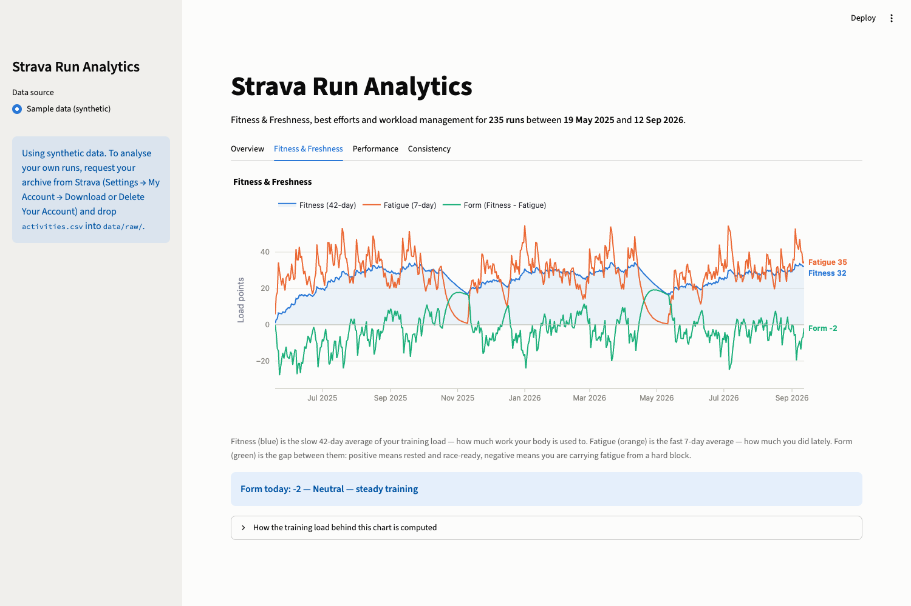

# Strava Run Analytics

Strava puts its most interesting running analytics behind a paywall: **Fitness &
Freshness**, best-effort curves and race-time predictions. This project rebuilds
all three from a plain Strava data export using a training-load model that is
written down in full rather than hidden — every number on the dashboard traces
back to a formula in this README and a function in `src/`. It ships with a
synthetic 16-month training history, so the dashboard is populated and
interactive the moment you start it, with no account and no API keys.



## Quick start

```bash
python -m venv .venv && source .venv/bin/activate   # Windows: .venv\Scripts\activate
pip install -r requirements.txt
python -m src.generate_sample        # writes data/sample/activities.csv
pytest -q                            # tests pass
streamlit run app.py                 # dashboard opens on synthetic data
```

Python 3.11+. The dashboard has six tabs — Overview, Fitness & Freshness,
Performance, Heart rate, Consistency and Sleep & HRV — and a sidebar with a switch between the
bundled sample data and your own export, plus your resting and max heart rate.

## What it computes

| Tab | What you get |
|---|---|
| **Overview** | Total distance, runs, hours and weeks tracked; current Fitness, Form and ACWR with a plain-English reading of each |
| **Fitness & Freshness** | CTL / ATL / TSB over time, plus the exact load formula behind the curve |
| **Performance** | Pace-vs-distance scatter with the best-effort frontier, the PR table, Riegel race predictions, an interactive race-time calculator, recent form vs all-time best, and 30-day rolling pace and heart-rate trends |
| **Heart rate** | Share of time in zones Z1–Z5, monthly hours by zone, and each zone's bpm range for your heart-rate settings |
| **Consistency** | Weekly distance, hours and run counts, monthly volume, current and longest weekly streak, and the acute:chronic workload ratio against its sweet-spot band |
| **Sleep & HRV** | Import a sleep-score / HRV CSV (Whoop, Oura, Garmin or the template) and see how each morning's reading correlates with the previous day's load, Fatigue and Form — see `src/recovery.py` |

## Methodology

Everything below is implemented in `src/` and covered by tests in `tests/`. The
constants are stated because a metric you cannot audit is a metric you cannot
argue with.

### Training load — `src/training_load.py`

Strava scores each activity with a proprietary "Relative Effort". This project
uses a duration × intensity model in the rTSS tradition, which is transparent and
reproduces the same qualitative behaviour.

**Step 1 — intensity factor.**

```
IF = threshold_pace / run_pace
```

Pace is in minutes per kilometre, so dividing threshold pace by the run's pace
gives a *speed* ratio: a run at threshold scores 1.0, a faster run scores above
1.0, an easy run below. Threshold pace is estimated from the athlete's own
history as the **fastest decile of runs of at least 5 km** — personal rather than
absolute, and distance-gated so that a 2 km sprint cannot masquerade as a
sustainable threshold effort.

**Step 2 — pace-based load.**

```
load_pace = duration_hours × IF² × 100
```

One hour at threshold pace equals 100 points by construction. The square is the
standard TSS convention: physiological cost rises faster than linearly with
intensity, so a 30-minute hard session outweighs a 30-minute jog by more than
their pace ratio alone would suggest.

**Step 3 — heart rate, when it is available.** Banister's TRIMP:

```
hrr   = (avg_hr − hr_rest) / (hr_max − hr_rest)        # heart-rate reserve, clipped to [0, 1]
TRIMP = duration_min × hrr × 0.64 × exp(1.92 × hrr)
```

TRIMP is then rescaled so that one hour at threshold heart-rate reserve (taken as
0.85) is also worth 100 points, putting it on the same axis as the pace score.
The two are blended 50/50 when `avg_hr` is present, and the pace score is used
alone when it is not — so a forgotten heart-rate strap never silently deflates a
day's training load. Defaults are `hr_rest = 60` and `hr_max = 190`; both are
function arguments, and both are assumptions rather than measurements.

Heart rate is blended in rather than ignored because it captures effort that pace
misses: heat, hills, wind and accumulated fatigue all raise the heart-rate cost of
the same pace.

**Step 4 — Fitness, Fatigue and Form.** Daily load is summed per calendar day over
a gap-free daily index, with rest days explicitly set to zero, then smoothed:

```
CTL_t = CTL_{t−1} + (load_t − CTL_{t−1}) / 42      # Fitness
ATL_t = ATL_{t−1} + (load_t − ATL_{t−1}) / 7       # Fatigue
TSB_t = CTL_{t−1} − ATL_{t−1}                      # Form, lagged one day
```

Both averages are exponentially weighted with time constants of 42 and 7 days —
the convention in the training-load literature, chosen so that fitness
accumulates over months while fatigue clears in about a week. Both are **seeded at
zero**, so fitness builds from nothing instead of inheriting the first recorded
run. Form is lagged one day because the freshness you carry into today's session
is the balance you finished yesterday with.

Reading the chart: Form above roughly +5 means rested and race-ready, around zero
means steady training, and deeply negative means a productive overload block that
needs to end soon.

### Best efforts and race predictions — `src/performance.py`

A best effort for distance *D* is the **fastest average pace over any run of at
least *D* kilometres**. The pace-vs-distance chart shows every run on a log-x
scatter with the Pareto frontier highlighted: the runs that no longer run beat on
pace, which is the activity-level equivalent of a power curve.

Race times use Riegel's endurance model:

```
T2 = T1 × (D2 / D1)^1.06
```

The exponent is Riegel's empirically fitted fatigue factor. An exponent of 1.0
would mean holding the same pace forever; 1.06 says the time penalty compounds
slightly faster than distance. It fits trained runners well between 5K and the
half marathon. It is *optimistic* for the marathon, where glycogen depletion and
the durability of one's long-run training matter more than an endurance exponent
can express — a 5K time extrapolated to 42.2 km should be read as a ceiling, not
a plan.

Predictions are drawn from the best effort in the **last 90 days**, not the
all-time best, so they describe current shape. The "recent form vs all-time best"
table makes that comparison explicit.

**Race-time calculator — `src/race_calculator.py`.** The same Riegel model, but
the reference effort is one you type in (a recent race, a time trial or a goal),
and the exponent is a slider from 1.01 to 1.15. Moving it shows how strongly a
marathon prediction depends on that one assumed number: from a 45:00 10K, the
marathon prediction moves from about 3:13 to 3:56 across that range.

### Heart-rate zones — `src/heart_rate.py`

Zones are defined on heart-rate reserve (Karvonen), the same
`hrr = (avg_hr − hr_rest) / (hr_max − hr_rest)` scale the TRIMP term uses, so the
sidebar's two heart-rate inputs drive both the training load and the zones:

| Zone | Name | % of heart-rate reserve |
|---|---|---|
| Z1 | Recovery | below 60% |
| Z2 | Aerobic | 60–70% |
| Z3 | Tempo | 70–80% |
| Z4 | Threshold | 80–90% |
| Z5 | VO2 max | 90% and above |

Each run's moving time is credited to the zone of its **average** heart rate,
because `activities.csv` carries no second-by-second heart-rate stream. Shares
are fractions of time on runs that recorded heart rate, so a forgotten strap is
left out rather than counted as easy running.

### Consistency and workload — `src/consistency.py`

Weekly and monthly volume are calendar aggregates, zero-filled so that time off
appears as a gap rather than being quietly closed up. A streak is consecutive
calendar weeks containing at least one run.

The acute:chronic workload ratio:

```
ACWR = mean daily load over the last 7 days / mean daily load over the last 28 days
```

Means rather than sums, so a perfectly steady block scores 1.0 regardless of the
window lengths. Between **0.8 and 1.3** — the band shaded on the chart — training
is in proportion to what the body has been prepared for. Well above it, load is
ramping faster than adaptation can follow, which is the pattern associated with
injury risk in the sports-science literature; below 0.8 is detraining. The ratio
is undefined until 28 days of history exist, and during a layoff, so those days
are left blank rather than plotted as zero or infinity.

ACWR is a *screening* signal, not a diagnosis. It is noisy at low volume, and its
thresholds are actively debated — which is why the dashboard shades the band and
lets you read your own trend rather than issuing a verdict.

## Using your own data

1. Go to **Strava.com → Settings → My Account → Download or Delete Your Account**.
2. Choose **Request Your Archive**. Strava emails a download link, usually within
   a few hours.
3. Unzip the archive and copy `activities.csv` into `data/raw/`.
4. Restart the dashboard. The sidebar now offers your export as a data source and
   selects it by default.

Nothing leaves your machine: the app reads the CSV from disk and there is no
network call anywhere in the codebase.

The loader is deliberately defensive, because Strava's export format has drifted
between versions. It filters to runs, accepts distances in either metres or
kilometres (inferred from magnitude), parses durations given either as integer
seconds or as `H:MM:SS`, strips thousands separators, coerces everything else with
`pd.to_numeric(errors="coerce")`, and drops rows with no date or a non-positive
distance or moving time — logging how many it dropped. The synthetic sample is
written in the same format and read through the same code path, so the loader is
exercised by the sample rather than bypassed.

## Limitations

- **Best efforts are activity-level, not true splits.** A "5K PR" here is the
  fastest average pace held over a run of at least 5 km, so a 5 km surge in the
  middle of a 20 km long run is invisible. Real in-run splits need the per-activity
  GPX streams, not `activities.csv`. Expect these numbers to be slightly
  conservative against Strava's own.
- **The training-load model is a transparent proxy, not Strava's formula.** The
  shape of the Fitness/Freshness curve matches; the absolute numbers will not, and
  they are not comparable to Strava's Relative Effort or to TrainingPeaks' TSS.
- **Threshold pace is estimated, not tested.** It comes from the fastest decile of
  your own runs, which drifts as you get fitter. It is not a lab or field test, and
  a period of only easy running will bias it slow.
- **`hr_rest` and `hr_max` default to 60 and 190**, which are not your values.
  Set yours in the sidebar: the heart-rate half of the load score and every zone
  boundary are only as good as those two numbers.
- **Heart-rate zones come from each run's average heart rate.** An interval
  session averaging Z3 really swung between Z1 and Z5, so the distribution
  understates both ends and overstates the middle. True time-in-zone needs the
  per-activity heart-rate streams.
- **Riegel assumes a constant fatigue exponent.** 1.06 is a population fit. It is
  pessimistic for well-trained marathoners and optimistic for beginners, and it
  cannot know whether you have done the long runs a marathon requires.
- **ACWR is contested.** The 0.8–1.3 band is widely cited and widely criticised;
  treat it as a conversation starter about your own trend, not a risk score.
- **Elevation and weather are ignored.** A hilly run and a flat run of the same
  pace score the same load, except insofar as heart rate picks up the difference.

## Repository layout

```
├── app.py                      # streamlit dashboard (tabs, KPIs, captions)
├── requirements.txt            # pinned dependencies
├── SPEC.md                     # the original project specification
├── data/
│   ├── raw/                    # drop your own Strava activities.csv here
│   └── sample/                 # generated synthetic export (not committed)
├── src/
│   ├── generate_sample.py      # realistic synthetic activities.csv
│   ├── loader.py               # export -> tidy DataFrame, defensively
│   ├── training_load.py        # load model, CTL / ATL / TSB
│   ├── performance.py          # best efforts, PRs, Riegel, pace trends
│   ├── consistency.py          # volume, streaks, ACWR
│   ├── race_calculator.py      # parse a typed time, Riegel at any exponent
│   ├── heart_rate.py           # HR-reserve zones, time-in-zone distribution
│   └── plots.py                # plotly figure builders
└── tests/                      # pytest: loader contract, load model, predictions, workload
```

### The synthetic data

`src/generate_sample.py` simulates about 16 months of training from a seeded RNG:
a slowly improving threshold pace with week-to-week noise, a realistic mix of
easy, tempo, long and short runs, rest weeks every fifth week, two multi-week
breaks followed by a decaying detraining penalty, heart rate correlated with
relative intensity plus cardiac drift on long runs, and roughly 10% of heart-rate
values missing. It also writes a few rides, walks and one zero-distance row, so
the loader's filtering and cleaning are exercised by the sample data.

### Tests

```bash
pytest -q
```

`tests/test_loader.py` covers the data contract — columns, dtypes, unit
inference, the run-only filter and the drop rules. `tests/test_training_load.py`
checks that a constant load converges to itself, that a spike moves Fatigue
exactly 42/7 times as hard as Fitness, and that Form is the one-day-lagged
difference. `tests/test_performance.py` checks Riegel against a hand-computed
value, best-effort selection and frontier logic. `tests/test_consistency.py`
checks that empty weeks survive aggregation as zeroes, that streaks break on a
rest week, and that ACWR reads 1.0 for steady training, spikes on a comeback
week and stays undefined during a layoff rather than dividing by zero.
`tests/test_race_calculator.py` checks time parsing (and that `5:75` is rejected
rather than read as 6:15) and that the exponent moves predictions the right way.
`tests/test_heart_rate.py` checks zone boundaries against hand-computed bpm,
that runs without heart rate are excluded from shares, and that empty months
are zero-filled.
